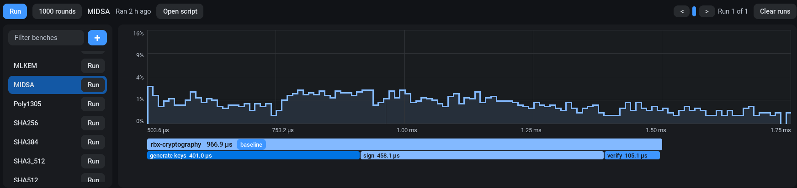

# rbx-bench

<p align="center">
	
</p>

<p align="center">
	<a href="https://discord.gg/Fg3sM8qKPp"></a>
	
	
	<a href="https://github.com/kohltastrophe/flux"></a>
</p>

<p align="center">
	<b>rbx-bench</b> is a benchmark plugin for Roblox Studio.<br>
	It times functions against each other, shows how their timings are spread, and breaks a case down into the parts you mark.
</p>

## Example

A bench is a ModuleScript that describes a suite. The plugin does the measuring.

```lua
--!strict
local Bench = require("../Bench")

local Suite = Bench.Suite("Sort", function(Size: number)
	local Values = table.create(Size, 0)
	for Index = 1, Size do
		Values[Index] = (Index * 7919) % 1009
	end
	return Values
end)
Suite:Sizes({ 100, 10_000 })
Suite:Fresh()

Suite:Case("in place", function(Values)
	table.sort(Values)
	return #Values
end):Baseline()

Suite:Case("clone first", function(Values)
	local Copy = table.clone(Values)
	table.sort(Copy)
	return #Copy
end)

return Suite
```

## Installation

Build the plugin with [Rojo](https://rojo.space) and put it in Studio's plugins folder:

```sh
rojo build default.project.json -o rbx-bench.rbxm
```

On Windows the folder is `%LOCALAPPDATA%\Roblox\Plugins`. Studio loads the plugin as soon as the file appears there.

## Using it

1. Open the **rbx-bench** panel from the Plugins tab.
2. Press **+** to create a bench. The plugin makes a `rbx-bench` folder in ServerStorage, holding the `Bench` module and a `Benches` folder, and opens the new bench.
3. Press **Run**.

- **Plot:** how each case's timings are spread. Hover it to see which cases have samples at that time.
- **Bars:** one per case, as long as its median. A badge says how it compares with the baseline.
- **Flame graph:** the spans a case ran, under its bar. A span that ran inside another sits on the line below it.
- **Rounds:** the button beside Run sets how many samples each case gets. A run that would take over 20 seconds asks first.
- **History:** runs are saved per place. The strip in the toolbar steps through them.
- **Disabling:** a bench, folder or adapter module whose name ends in `.disabled` is skipped.

A run is thrown away, with the reason in red, when a rule fails or when the baseline's two timings in each round disagree by more than 5%.

## API

### Suite

| Call | What it does |
|---|---|
| `Bench.Suite(Name, Input)` | Makes a suite. `Input(Size)` builds what every case is called with. |
| `Suite:Sizes({ ... })` | The input sizes to run. Each gets its own results. |
| `Suite:Label(Describe)` | How a size is shown, such as `50 KB`. |
| `Suite:Fresh()` | Calls `Input` for every call, outside the timing, for cases that change their input. |
| `Suite:Case(Name, Run)` | Adds a case. Chain `:Baseline()` or `:Skip()`. |
| `Suite:Span(Name)` | Makes a span. Wrap part of a case in `Span:Start()` and `Span:Stop(Mark)`. |
| `Suite:BeforeAll(Hook)`, `Suite:AfterAll(Hook)` | Run once around the whole run. `AfterAll` also runs when the run fails or is cancelled. |
| `Suite:BeforeEach(Hook)`, `Suite:AfterEach(Hook)` | Run around every batch of a case's calls, outside the timing. |
| `Suite:Rule(Name, Check)` | `Check(Run)` returns whether the run passes, and a message when it does not. |
| `Suite:Metric(Name, Compute)` | `Compute(Run, Case)` returns a number shown in the case's hover card. |

### Spans

```lua
local Encode = Suite:Span("encode")

Suite:Case("round trip", function(Input)
	local Mark = Encode:Start()
	local Encoded = Base64.Encode(Input)
	Encode:Stop(Mark)

	return Base64.Decode(Encoded)
end)
```

Spans cost a call and a branch while timing. They are recorded in a separate pass.

### Rules

```lua
Suite:Rule("fast path stays faster", function(Run)
	local Comparison = Run:Compare(Fast, Slow)
	return Comparison.Significant and Comparison.Ratio < 1, `ratio {Comparison.Ratio}`
end)
```

| Call | Returns |
|---|---|
| `Run:Of(Case)` | `Min`, `Median`, `Mean`, `P90`, `Low`, `High`, `Spread`, `Samples` and `Bytes` per call. Times are nanoseconds per call. |
| `Run:Compare(First, Second)` | `Ratio` of the first to the second, its `Low` and `High` bounds, and whether it is `Significant`. |
| `Run:Span(Case, Span)` | The span's `Time`, `Count` and `Share` in that case. |
| `Run.Previous` | The same size from the run before, when there is one. |

### Fresh requires

Studio caches a module the first time it is required. A bench is run from a fresh copy every time, and `Bench.Import` does the same for a module outside it:

```lua
local Library = Bench.Import(ReplicatedStorage.Library)
```

`Bench.Modules(script)` imports every ModuleScript child of a bench and returns them as `{ Name, Value }`, in name order, which makes one adapter module per library an easy way to compare libraries.
